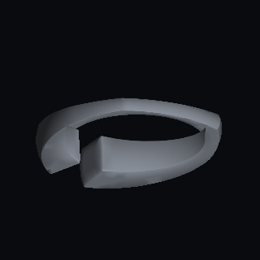
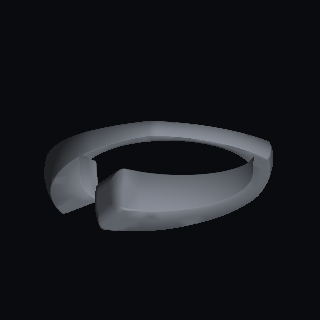
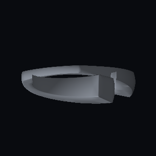
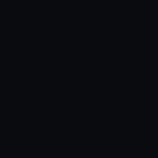

# Actual CAD-to-Metal checkpoint

Source: current iPad/iPhone simulator run [41182340484](https://github.com/azerish25-ux/jewel-design-ipados/actions/runs/41182340484), commit `1b62e5896c5101cc2ea0c2c5006ad2f69a978851`. The unchanged native kernel was validated against producer [41181433871](https://github.com/azerish25-ux/jewel-design-ipados/actions/runs/41181433871) before reuse. [Full evidence](../metal-viewport-results.json).

These frames render the actual generated native output 140 of the recovered library design. The mesh contains 5,544 source triangles and 5,622 after editing radius by +0.4 and cap thickness to 0.8. The material is neutral test lighting. Full application UI, original rendering/camera behavior, original-PC and physical-device acceptance remain open.

| Check | Actual result |
| --- | --- |
| CAD foreground | 16,109 pixels |
| Edit changes | 12,377 pixels |
| Orbit changes | 19,835 pixels |
| Reverse triangle submission | 0 changed pixels in the real GPU harness |
| Independent PNG verification | Decoded pixels reproduce the original raw BGRA hash and all foreground/edit/orbit counts |

## Original and edited

## Camera orbit and empty scene

The PNGs are retained exactly as produced, and all four images are byte-identical across both simulator families and source checkpoints. The reverse-submission raw frame was compared inside the harness; its separate PNG is not part of this set.

Reproduce pixel verification and corruption/report regression checks:

    node scripts/verify-metal-artifacts.cjs docs/evidence/apple/metal-viewport
    node --test tests/metal-artifacts.test.cjs

The verifier is a bounded evidence decoder for non-interlaced 8-bit RGBA PNGs. It validates existing rendered pixels and CRCs; product image import has separate requirements.
