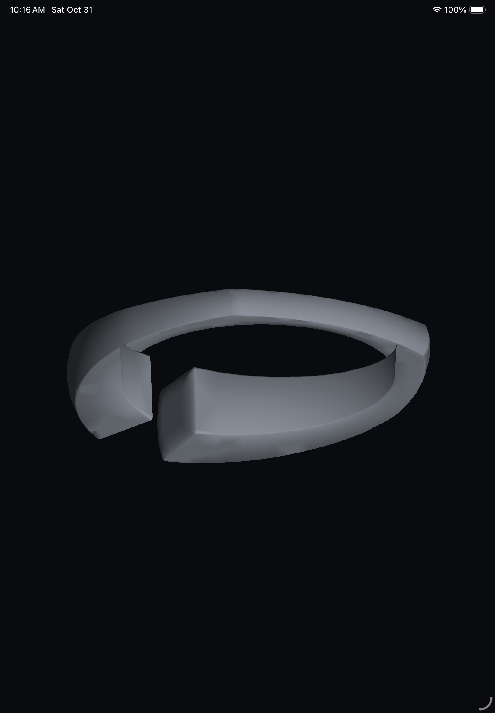
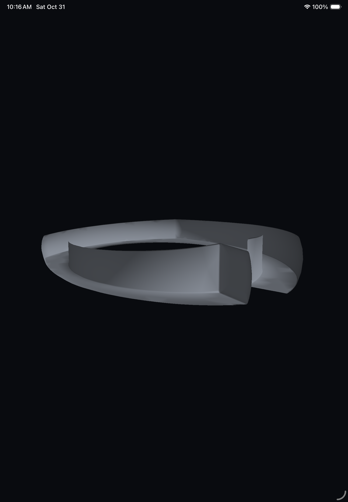
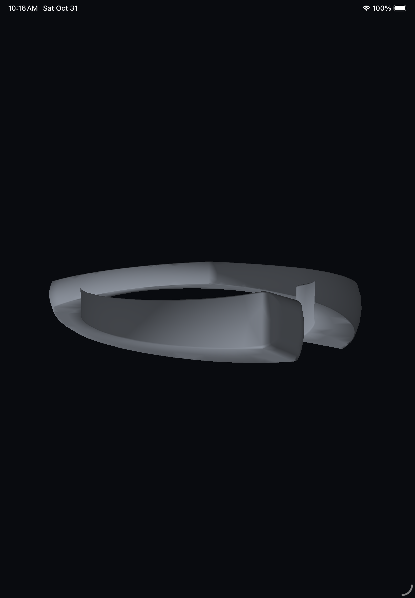
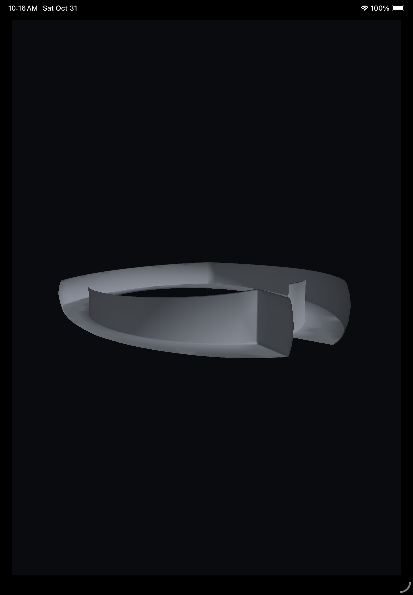
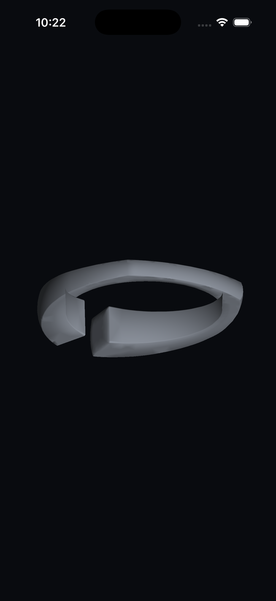

# Actual on-screen CAD viewport checkpoint

[macOS run41190815914](https://github.com/azerish25-ux/jewel-design-ipados/actions/runs/41190815914) at commit1feab10 passed on iPad/iPhone simulators. [Complete evidence](../visible-viewport-results.json).

This engineering test window uses the real MTKView renderer and regenerated native output140 from the recovered library design. The final application controls/layout, source camera/lens, materials, picking/touch, PC and physical-device acceptance remain open.

| Measured central screen-region check | iPad | iPhone |
| --- | ---: | ---: |
| CAD foreground pixels | 428,796 | 232,581 |
| Edit changes, same orbit camera | 64,797 | 35,906 |
| Orbit changes | 517,987 | 283,622 |
| Resize changes, same orbit camera | 181,766 | 144,759 |
| Final fresh view difference | 0 | 0 |
| Peak outstanding frames | 2 | 3 |
| Outstanding frames at disposal | 2 | 1 |
| Retired mesh buffers after completion | 0 | 0 |

Native presentation timing is unavailable in this pinned simulator. Reports retain null timestamps and distinguish GPU completion; actual displayed content is verified using fresh screenshots and pixel checks. Supporting-device native timing remains an acceptance requirement. The original offscreen BGRA hash is unchanged after sharing the encoder.

## Actual iPad captures

## Actual iPhone capture

All six stage PNGs and runtime reports are retained under each family directory. Verify their actual pixels and resource/timing declarations:

    node scripts/verify-viewport-screenshots.cjs docs/evidence/apple/visible-viewport/ipad
    node scripts/check-viewport-report.cjs docs/evidence/apple/visible-viewport/ipad/report.json
    node scripts/verify-viewport-screenshots.cjs docs/evidence/apple/visible-viewport/iphone

Source controls are exercised by the harness through real parameter generation; no physical touch test or complete product UI is claimed here.
