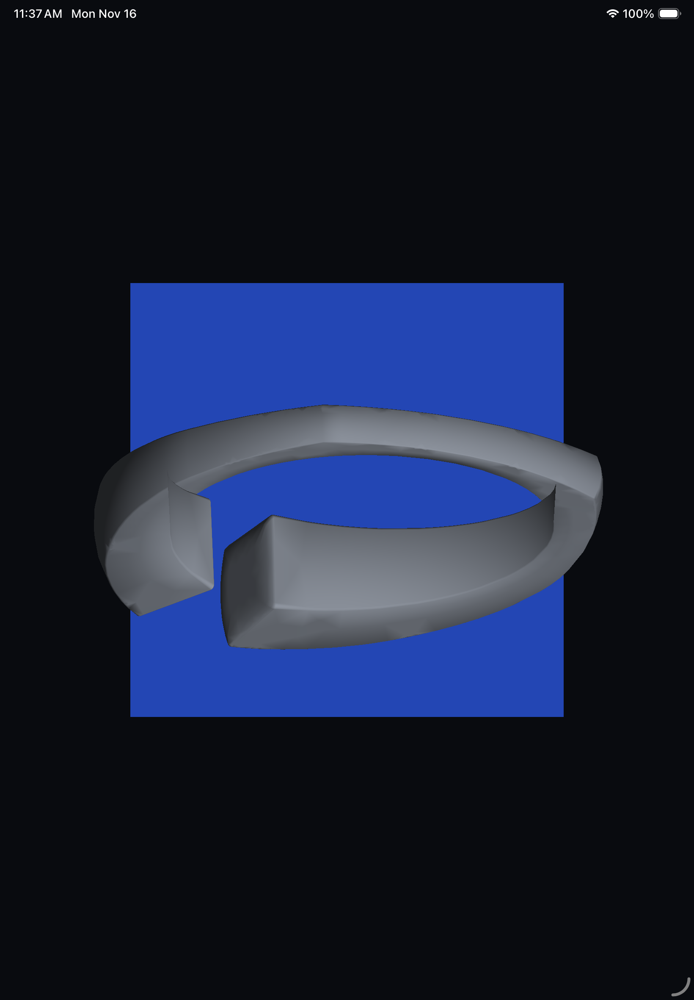
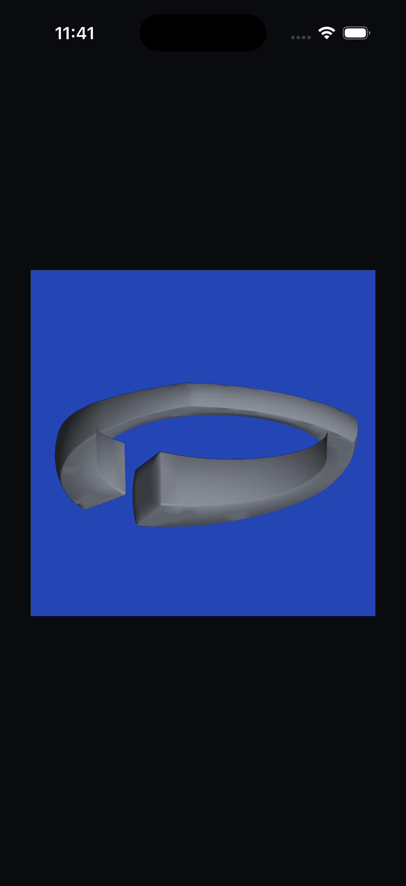

# Actual visible wallpaper/CAD captures

Source b2950d8d0b7952c5ee75a2a79c24098f794276e4, run43858605723. Unmodified actual simulator captures downloaded through connected owner plugin and verified against artifact SHA256. These are analytical opaque wallpaper pixels composed behind real regenerated library CAD, not an original-PC quality comparison or complete application UI.

[Complete pixel/resource results](../visible-wallpaper-ios-results.json). All12 CAD/image stages remain in the D: artifact workspace and retained Actions artifact. Source resampling/camera/material/trace/document/PC/physical acceptance remains open.
